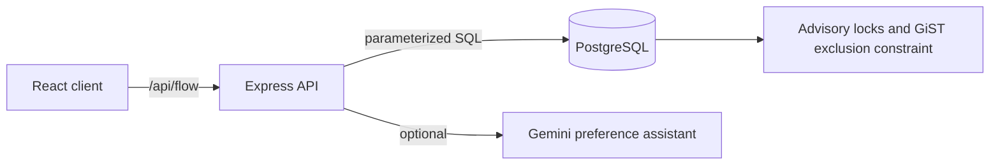

# BookFlow architecture

BookFlow is an npm-workspaces application with a React client, an Express API,
and PostgreSQL. The active API is `/api/flow`; older BookIt route modules in the
repository are not mounted. In production, Express serves the built client from
the same origin as the API. During development, Vite proxies `/api` to Express.

## Booking path

The customer searches resource and service availability, then requests a
five-minute hold. The server starts a transaction, locks that resource, expires
old holds, and recomputes availability. A matching slot becomes a `held` booking.
Confirmation changes it to `confirmed`; cancellation and expiry release it.
Rescheduling checks the new slot in a transaction and preserves the old booking
if the change fails. Waitlist promotion creates a real protected hold.

The database exclusion constraint protects each resource's blocked range,
including preparation and cleanup buffers. Half-open ranges permit adjacent
bookings. The assistant provides search preferences only and cannot bypass the
booking transaction.

## Published seat pools

An owner may publish a seat pool for one resource and session, with exact rows,
blocked seats, a request deadline, and a confirmation window. Ordinary direct
bookings remain available at other times. Cross-table triggers and resource
locking reject any direct booking whose protected time range overlaps a pool.

After the deadline, the maintenance worker solves the waiting groups together.
The exact branch-and-bound solver enumerates valid contiguous blocks and uses
lexicographic objectives: maximize occupied seats, minimize separate empty
runs, then favor older requests. If its search limit is reached, the transaction
rolls back without issuing new offers. Assignments have a database uniqueness
constraint per pool and seat. Confirmed and live offered seats remain occupied;
expired or cancelled offers release their assignments for another allocation.
An owner can withdraw a pool with no confirmed groups; its waiting requests
and offers are cancelled and ordinary availability is restored.

## Identity and isolation

Customer and owner accounts use bcrypt password hashes and separate JWT kinds.
Every protected API request checks the token's session version against the
account row. Password changes and sign-out increment that version, revoking all
issued tokens for the account. Customer tokens expire after 30 days and owner
tokens after seven days. Owner mutations are scoped to the owner's
organization. PostgreSQL stores shared request-limit counters.

New public accounts use one-time email verification links. Password recovery
uses a separate 30-minute link. Only SHA-256 hashes of action tokens are stored;
redeeming a recovery link also revokes issued sessions.

## Runtime

`server/src/app.ts` mounts the API, health route, and built client with an SPA
fallback. `server/src/index.ts` starts a 15-second maintenance loop for hold
expiry, waitlist offers, seat-pool allocation, and local notification outbox work. For multiple web
instances, disable the loop in web containers and run one worker with a direct
database connection. Migrations are versioned in `server/src/db/migrations`;
the build copies the SQL files into `server/dist/db`.

The active flow provides in-app notifications, local HTML outbox files, and
optional SMTP delivery with retries.
Prices are informational. The repository retains older payment and email modules
that are not part of the active BookFlow API.

See [the verified flow and schema](VERIFIED_FLOW_AND_SCHEMA.md) for request
sequences and tables, and [deployment steps](DEPLOYMENT.md) for runtime setup.
