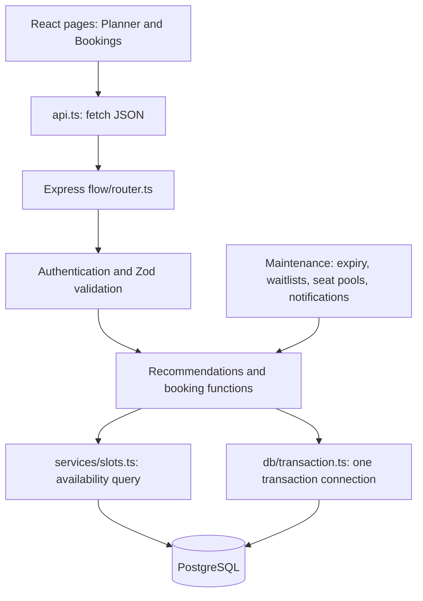

# BookFlow: architecture, low-level design, and running locally

## The system in one sentence

The browser asks an Express API for available resource sessions; the API uses
PostgreSQL to calculate availability and safely store reservations.

## Architecture



This is one backend application with modules, not a microservice system. The
worker is a background execution path; it can run in the web process or as a
separate process. Redis and WebSockets are not part of the active request flow.

## Responsibilities and dependencies

| Module | Responsibility | What it calls |
| --- | --- | --- |
| `client/src/main.tsx` | Mount React into the HTML root | `App` |
| `client/src/App.tsx` | Choose a page for a browser URL | Page components |
| `client/src/flow/Planner.tsx` | Collect preferences and display choices | `request()` |
| `client/src/flow/Bookings.tsx` | Display reservations and send actions | `request()` |
| `client/src/flow/api.ts` | Send HTTP JSON and handle API errors | Browser `fetch()` |
| `client/src/flow/session.ts` | Read persisted browser sessions and check local expiry | Browser storage |
| `client/src/flow/AccountRoutes.tsx` | Share the account-required page entry screen | Session context and nested routes |
| `server/src/index.ts` | Listen for requests; start maintenance | Express app, maintenance |
| `server/src/app.ts` | Parse JSON, mount API, serve built frontend | `flowRouter` |
| `server/src/flow/router.ts` | Match method/path, check access, validate input, respond | Feature functions |
| `server/src/middleware/auth.ts` | Verify account and session access | JWT library and database |
| `server/src/middleware/errors.ts` | Raise HTTP errors and format responses | Express response |
| `server/src/flow/recommendations.ts` | Rank valid sessions | Availability function |
| `server/src/services/slots.ts` | Calculate current available sessions | PostgreSQL queries |
| `server/src/flow/booking.ts` | Enforce booking transitions and resource locks | Availability and transaction helpers |
| `server/src/db/transaction.ts` | Begin, commit/roll back, release one connection | PostgreSQL pool |
| `server/src/db/pool.ts` | Manage reusable database connections | `pg` library |
| `server/src/db/migrate.ts` | Apply versioned schema changes | SQL files and PostgreSQL |

Some routes still contain account/profile SQL directly. The current structure is
an incremental improvement, not a claim that every module is fully separated.

## Four operations in the booking design

| Operation | API | Input | Result / writes |
| --- | --- | --- | --- |
| Search | `POST /api/flow/recommendations` | Resource, service, date, time, flexibility | Ranked available sessions; no reservation |
| Hold | `POST /api/flow/holds` | Resource, service, explicit start | Insert one held booking with a five-minute expiry |
| Read bookings | `GET /api/flow/bookings` | Verified customer token | Customer's current booking list |
| Confirm | `POST /api/flow/bookings/:code/confirm` | Booking code and optional version | Update the held booking to confirmed |

Search results are snapshots. A hold must recheck availability inside a
transaction. Do not use a previous search result as proof that a slot is free.

## Follow the variables in slots.ts

1. `providerResult = await db.query(...)`: get the query result object.
2. `provider = providerResult.rows[0]`: select the single matching resource.
3. `serviceResult = await db.query(...)`: get the selected resource's service.
4. `service = serviceResult.rows[0]`: select that service.
5. `availabilityResult = await db.query(...)`: calculate all valid sessions.
6. `availableRows = availabilityResult.rows`: keep every available session row.
7. `slots = availableRows.map(...)`: convert database Date values to strings.
8. `return { provider, service, slots }`: return to the backend caller.
9. `recommend()` ranks slots; the route sends its result through `res.json()`.
10. React receives JSON and updates state to render the choices.

The first two queries return zero or one matching row. The availability query can
return many rows. The pg library already represents rows as JavaScript objects;
reading rows[0] does not perform a conversion.

## Data model

An organization owns locations and resources (`providers`). A resource has
services, weekly schedules, breaks, and dated time off. A booking references a
customer, resource, and service, and records its time and state. Audit events
record transitions. Separate allocation requests represent waitlist demand.
Seat pools represent a different, optional group-allocation workflow.

Store rules and real reservations, not a permanent row for every free session.
For example: opening 09:00–12:00, duration 60, start interval 60, zero buffers
produces 09:00–10:00, 10:00–11:00, and 11:00–12:00. An interval of 15 instead
also permits 09:15–10:15 and 09:30–10:30. These are competing choices, not
simultaneous reservations.

## Booking invariants for an LLD discussion

- One active reservation per resource at any occupied instant.
- Preparation and cleanup are part of the occupied range.
- A service must be associated with its resource.
- Customer actions operate on the customer's own bookings.
- Owner management operates within the owner's organization.
- Expired holds cannot be confirmed.
- Failed rescheduling preserves the original reservation.
- Database writes and their audit events commit together.

Per-resource transaction locks serialize cooperating reservation attempts.
Availability is rechecked after acquiring the lock. The GiST exclusion constraint
is the final database rule against active overlaps. Row locks and version checks
protect updates to existing bookings. These are separate responsibilities.

## Software development rules used here

- Separate screen rendering, HTTP routing, feature logic, and database setup.
- Use explicit names and assignments when compact syntax obscures data flow.
- Share transaction/error helpers rather than importing unrelated booking logic.
- Validate external input at the API boundary, and enforce data invariants in SQL.
- Use parameterized values rather than interpolating user input into SQL.
- Keep one database connection throughout a transaction.
- Preserve historical booking prices and occupied ranges.
- Use integration tests for concurrency and database rules.

## Is this OOP? What is its LLD?

Most active code uses functions, modules, React function components, and plain
data objects. It is not a class-based domain model: there are no Customer,
Booking, or Resource classes encapsulating the full business behavior. Database
tables and TypeScript types do not by themselves constitute OOP.

There is a small OOP example in flow/assistant.ts: MockProvider and
DisabledProvider implement AIProvider. They provide interchangeable parse
behavior through a shared interface. This does not describe the whole backend,
and the active Gemini chat integration is function-based.

Low-level design does not require classes. Here it consists of the responsibilities
and dependencies above, endpoint inputs/outputs, entity relationships, booking
state transitions, transaction boundaries, locking, and error behavior. In an
interview, describe this as a function-based modular application with a relational
data model. Avoid claiming that the system demonstrates all four OOP pillars.

## One sign-in session, consistent access

The context restores the saved account on reload. API requests attach its token,
and the backend verifies both the token and stored session version. Normal page
navigation does not clear the session. Personal navigation links appear for
signed-in customers, owner management appears for owners, and Inbox supports both.
Direct personal URLs use AccountRoutes, so guest sign-in behavior is centralized.

Public search/chat/seat-pool browsing remain available. Creating a reservation or
seat request requires a customer account. Switching between owner and customer
accounts deliberately signs out the previous role. Browser storage is scoped to
the origin, so localhost and 127.0.0.1 (or different ports) do not share sessions.
Expiry, explicit sign-out, password changes, and server revocation can require a
new sign-in; network errors alone do not clear the token. The screenshot's G
avatar indicates a guest, not proof of a second login demand for a valid session.

## First-time local setup

Requirements: Node.js 22 or newer, npm, and running Docker Desktop.
Run commands from the repository root.

```bash
npm ci
```

If `server/.env` does not exist, create it from the example. Do not overwrite an
existing configured environment file.

```bash
cp server/.env.example server/.env
docker compose up -d db
npm run db:setup
npm run dev
```

`db:setup` applies migrations and inserts demo data. It is only for an empty
business database. The seed deliberately refuses to overwrite populated data.

Open http://localhost:5175. The API listens on port 4170. Vite forwards browser
requests beginning `/api` to that API. PostgreSQL is exposed locally on 54329.

Demo customer: customer@bookflow.local / customer123.
Demo owner: admin@bookflow.local / admin123.
These are local demo credentials only. AI and SMTP are optional for local use.

## Normal start on later days

The database for this workspace was initialized during the review. Open Docker
Desktop, then run:

```bash
docker compose up -d db
npm run dev
```

For new migrations, use `npm run db:migrate`; do not rerun demo seeding.
Stop the development processes with Ctrl+C. `docker compose stop db` stops the
database while keeping its persisted data.

## Useful verification commands

```bash
npm run typecheck
npm run build
npm test
npm run format:check
```

Tests create and remove a separate disposable database; the development database
is not truncated. Check http://localhost:4170/api/health for database connectivity.
If maintenance fails, inspect its logged error code/message, check Docker, and
check that migrations were applied. Do not disable maintenance as a fix: it
performs hold expiry and allocation work.

## Design choices to revisit

See REVIEW_2026-10-09.md for concrete remaining defects and verification limits.
The owner form hard-codes a 15-minute start interval; the backend supports other
values. The UI should let the owner choose based on the business's scheduling
rules. Fixed hourly starts and flexible starts are both valid policies.

The original schema and unused legacy code complicate learning. Removing them
requires a deliberate migration/compatibility plan, not deleting schema files
that existing installations depend on. The current router is large and could be
split into account, catalog, booking, and owner route modules in a later change.

Optional exact seat allocation is much more complex than ordinary booking. Study
it after the core flow; removing its search limit or database checks would make
the implementation less reliable. Complete browser and production checks remain
necessary before claiming a production-ready system.
